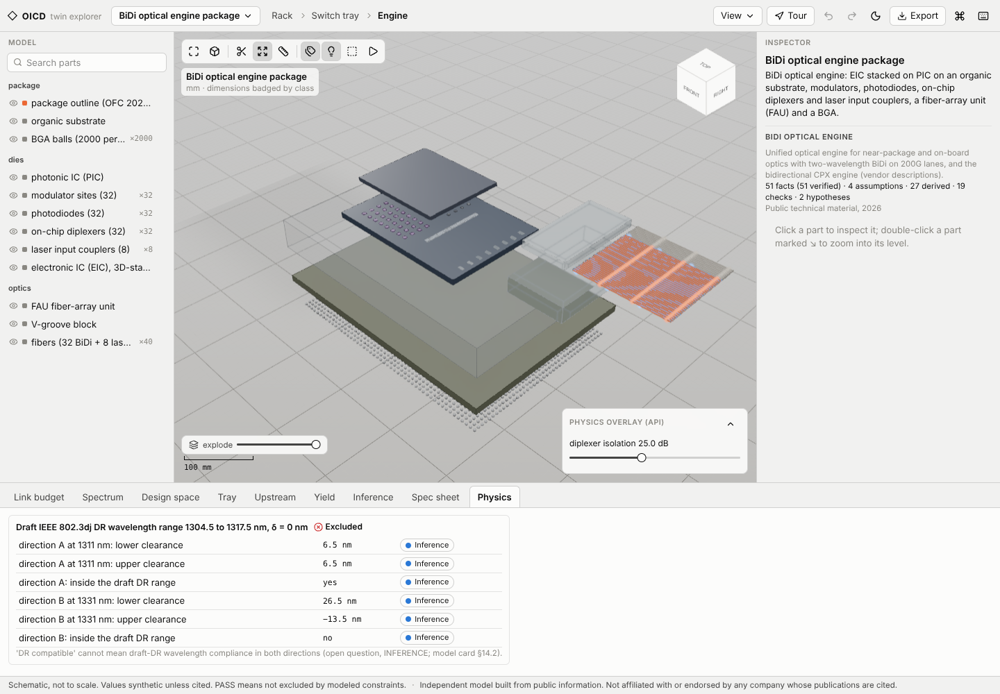

# OICD

Feasibility engine for optical interconnect in AI clusters, with a 3D explorer from rack to microring.

A learning project. Co-packaged optics (CPOs) is one of the most active topics in photonics, but the material is spread across slides, datasheets and draft standards, and CAD tools are hard to pick up. OICD puts it in one place you can open in a browser, click through and check against the math.


OICD checks whether a link, tray or rack closes: electrical interface, wavelength plan and worst case OMA budget, plus MPI, BiDi reflection crosstalk, microring and WDM physics, sweeps and yield. Every number is tagged with where it came from (published spec, draft standard, vendor claim, peer reviewed, assumption or inference) and cited in [references.bib](references.bib).

Models include a 3D photonic interposer, CPO chiplets, a BiDi DR optical engine, a 16λ single fiber BiDi link, external laser sources, CPO trays in an Open Rack, and a photonic tensor core processor.

| | |
| --- | --- |
|  |  |
|  |  |

## Findings

1. The same worst case rack path is −1.0 dB or +2.0 dB depending on which side of a detachable fiber connector the budget is measured.
2. Interleaving a 16λ BiDi link buys about 6 dB of isolation only if the ring FSR is at least 3.2 THz.
3. A 99% yield over 8,192 links needs about 4.7σ per link.

## Run

```bash
uv sync --all-groups
cd web && npm install --legacy-peer-deps && cd ..
./scripts/dev.sh          # API on :8000, explorer on :5173
uv run oicd rack          # same numbers from the CLI
```

In the explorer, `?` lists shortcuts, `Ctrl+K` searches every part and analysis, and the Tour button walks a scene's facts.

Tests: `uv run pytest`, and `npm run test:unit` / `npm run e2e` in `web/`.

## Learn

Start with the [model card](docs/model_card.md): every equation, reference plane and worked case, with the [hand calculations](docs/hand_calcs/) behind them. The [twin pages](docs/twin/) list each sourced fact, and the [paper draft](docs/paper/main.md) ties it together.

Found a wrong number? [Open an issue](CONTRIBUTING.md). Corrections are the most useful contribution.

## Limits

Worst case over the modeled constraints only (BER, TDECQ, dispersion and thermal are not evaluated). Draft 802.3dj values may change. Geometry is schematic wherever a dimension isn't public. Not affiliated with any company whose work is cited.

Built with an AI coding assistant (Claude Code), directed and reviewed by me. Agent rules are in [AGENTS.md](AGENTS.md).

Apache-2.0 · Pranav Reddy
