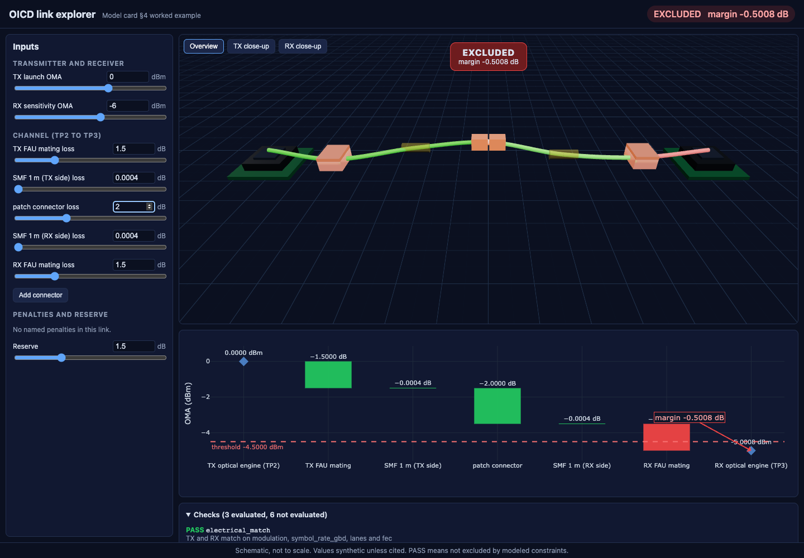

# OICD: Open Interconnect Co-Design

OICD is a physics-grounded feasibility engine for optical AI-accelerator interconnects: it checks whether a point-to-point optical lane is excluded by its electrical interface, wavelength plan or worst-case OMA power budget, and records the provenance of every number it uses. An interactive 3D explorer shows the link, its power waterfall and the verdict, all computed by the Python engine.



## Run it

```bash
uv sync
cd web && npm install && cd ..
./scripts/dev.sh
```

`scripts/dev.sh` starts the API on http://127.0.0.1:8000 and the explorer on http://localhost:5173. Ctrl+C stops both.

Checks:

```bash
uv run pytest -q && uv run ruff check .
cd web && npx tsc --noEmit && npm run build && npx playwright test
```

## Pipeline

```
profiles/*.json ──► schema (Link) ──► checks ──► report ──► API ──► 3D explorer
  synthetic or       units, OMA vs     electrical,  verdict,     FastAPI     React, three.js,
  cited inputs       average, invalid  wavelength,  power trace, /evaluate   Plotly; display
                     physics rejected  power budget provenance   /profiles   only, no physics
```

The engine is the only place physics is computed. The explorer sends the edited Link to `POST /evaluate` and displays the report it gets back. It never computes dB, margins or verdicts. The equations, reference planes (TP2 to TP3) and expected test values are in [docs/model_card.md](docs/model_card.md).

## Limitations

- **Synthetic values.** Every value in the shipped profile is synthetic: realistic, but not taken from a datasheet. Each input says so in its provenance.
- **Single lane.** A link is one point-to-point lane. There is no multi-lane, breakout or WDM aggregation.
- **No BER prediction.** BER, TDECQ, dispersion, reflections/MPI, thermal behavior and reliability are always reported as `NOT_EVALUATED`. A PASS means "not excluded by the modeled constraints", never "the link works".
- **Not a compliance tool.** OICD is not an OCP or IEEE 802.3 compliance tool, and its results do not certify conformance to any specification.
- **Schematic 3D.** The explorer is schematic and not to scale.

## References

From [references.bib](references.bib). Only sources that were actually opened are listed there, and each entry's note records its information class.

- `ocp_osp_initiative_2026`: OCP Launches Open Silicon Photonics for AI Systems Initiative, Converge Digest, 2026 (proposed architecture vision, news summary).
- `ocp_osp_vision_2026`: Architecture Vision: Open Silicon Photonics for AI Systems, Open Compute Project, 2026 (listed, not yet read).
- `lightmatter_guide_2026`: Lightmatter Introduces Guide Light Engine for AI, Featuring VLSP Technology, Lightmatter, 2026 (vendor claim).
- `lightmatter_l20_2026`: Lightmatter unveils Passage L20 photonic interconnect, announces vClick Optics, DatacenterDynamics, 2026 (vendor claim).
- `lightmatter_openrack_2026`: Lightmatter Delivers Open Rack CPO Switch and XPU Scale-Up Server, Lightmatter, 2026 (vendor claim).
- `oif_elsfp_2023`: OIF serves up external laser small form-factor pluggable (ELSFP) implementation agreement, Lightwave, 2023 (article about a published specification).
- `gu2026llmcircuits`: Gu, Kemeny, Yelin and Lukin, Discovering state-of-the-art quantum circuits with large language models, arXiv:2610.22367, 2026 (method reference).

No value in the current engine or profiles cites these yet. They are background for later milestones.

---

Code implemented with an AI coding assistant; models, physics and design decisions by Pranav.
