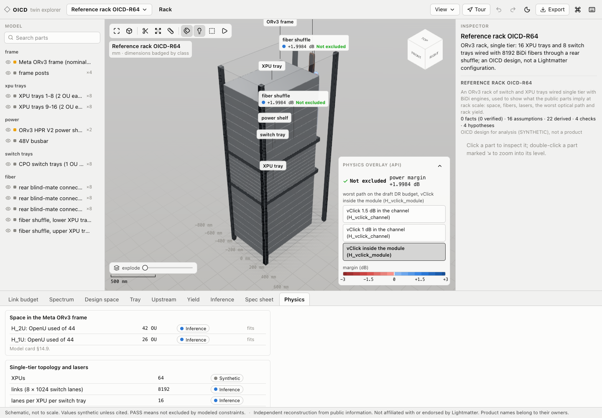
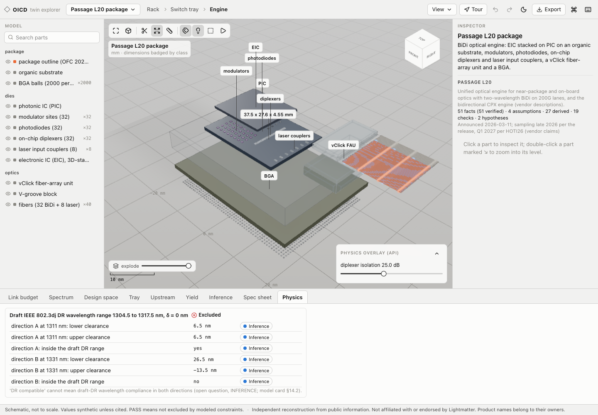
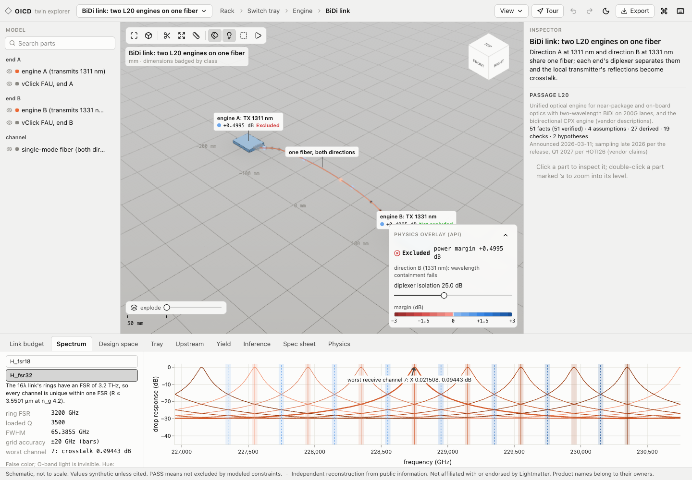
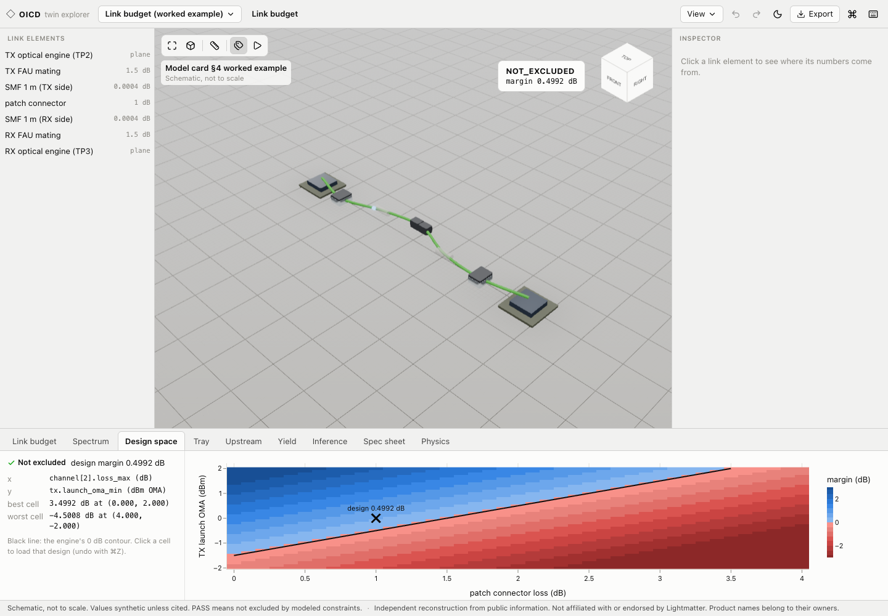
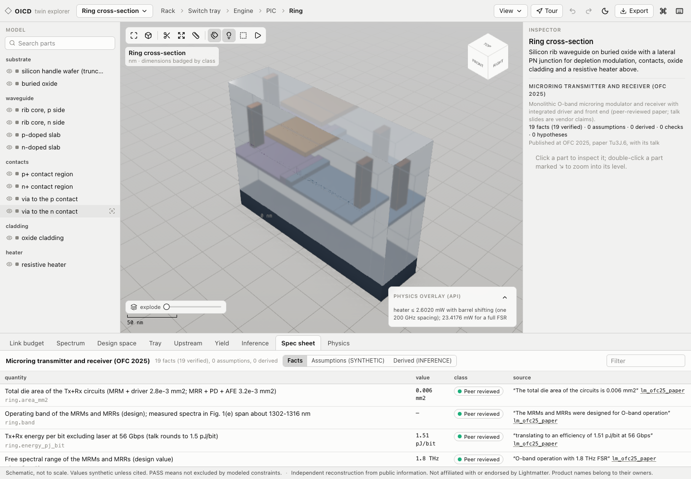

# OICD: Open Interconnect Co-Design

OICD is a physics-grounded feasibility engine for optical AI-accelerator interconnects, with a product twin of one company's public interconnect line and a CAD-grade 3D explorer. It checks whether an optical link is excluded by its electrical interface, wavelength plan or worst-case OMA power budget, and it records where every number came from: each value carries a class (PUBLISHED_SPEC, PROPOSED_STANDARD, VENDOR_CLAIM, PEER_REVIEWED, THIRD_PARTY, SYNTHETIC or INFERENCE) and, when it is cited, a source in [references.bib](references.bib).



## Features

- **Link engine.** Worst-case OMA budget between named reference planes (TP2 to TP3), dB and dBm as distinct types, OMA and average power as distinct kinds, three-state checks (PASS, FAIL, NOT_EVALUATED) with evidence. A PASS means "not excluded by the modeled constraints", never "the link works".
- **Analyses.** Design-space sweeps with the engine's 0 dB contour, multi-lane trays, an upstream laser chain with maximum fan-out, statistical yield, the draft IEEE 802.3dj 200G DR budget, worst-case MPI, BiDi reflection crosstalk, microring and WDM physics, a reference rack and a scale-up pod.
- **Product twin.** A catalog of public facts with their exact quotes, SYNTHETIC assumptions, derived values with derivations, consistency checks, and competing hypotheses carried side by side with a support matrix ([docs/twin/](docs/twin/), [public spec sheet](docs/lightmatter_public_spec_sheet.md)).
- **Photonic processor.** An independent re-implementation of the adaptive block floating-point data path of the 2025 Nature photonic processor, with seeded experiments.
- **Explorer.** Rack › tray › engine › PIC › ring at their own scales, PBR materials, feature edges, sections with hatched caps, exploded views, a snapping measure tool, guided tours, physics overlays (false-color light, pulses at the engine's linear power, margin colormaps, heater power) and analysis tabs, every number from the API.

| | |
| --- | --- |
|  |  |
|  |  |

## The product twin

The twin reconstructs Lightmatter's public interconnect products (Passage M1000, L200 and L200X, L20, the OCP 2026 switch and XPU trays, Guide, Guide 1 and Guide DR, vClick, a 16-wavelength BiDi link and the 2025 photonic processor) from public sources only, reverse-engineers what the public numbers imply, and labels every number by where it came from. Inferences are never presented as specifications; where two sources disagree, both are kept as a recorded conflict, and where a claim has two readings, both are carried as hypotheses.

> **Independent reconstruction from public information. Not affiliated with or endorsed by Lightmatter. Product names belong to their owners.**

## Run it

```bash
uv sync --all-groups
cd web && npm install --legacy-peer-deps && cd ..
./scripts/dev.sh
```

`scripts/dev.sh` starts the API on http://127.0.0.1:8000 and the explorer on http://localhost:5173. The command line gives the same numbers without the browser:

```bash
uv run oicd evaluate worked_example
uv run oicd sweep worked_example --x "channel[2].loss_max" 0 2 21 --y tx.launch_oma_min -1 1 21
uv run oicd fanout upstream_example
uv run oicd twin passage_l20
uv run oicd rack
```

Checks: `uv run pytest -q`, `uv run ruff check .`, `uv run mypy`, and in web/ `npm run typecheck`, `npm run test:unit`, `npm run build`, `npm run e2e`. Figures: `uv run python scripts/make_figures.py`; twin pages: `uv run python scripts/make_twin_docs.py`.

## Pipeline

```
references.bib, catalog/*.toml, profiles/*.json
        │
        ▼
schema and catalog validation ──► checks, analyses, physics, inference graph, hypotheses
        │                                       │
        ▼                                       ▼
FastAPI (canonical JSON, generated TypeScript types) ──► explorer, CLI, figures, twin docs
```

The engine is the only place physics or inference is computed; the explorer displays API responses, including colors. The equations, reference planes and expected test values are in [docs/model_card.md](docs/model_card.md), and docs/hand_calcs/ reproduces every number it quotes with the Python standard library. More: [architecture](docs/architecture.md), [paper draft](docs/paper/main.md), [five-minute demo](docs/demo_script.md), [figures](docs/figures/).

## Limitations

- **Worst case on a subset of constraints.** BER, TDECQ, dispersion, thermal behavior and reliability are NOT_EVALUATED.
- **Public information only.** The twin knows what sources say, not what the products are; inferences are labelled INFERENCE and assumptions SYNTHETIC. The reference rack is an OICD design.
- **Draft standards.** IEEE P802.3dj values are a draft (PROPOSED_STANDARD), not an approved standard.
- **Schematic geometry.** Wherever a dimension is not public, the explorer draws a SCHEMATIC part and says so.
- **Not a compliance tool.** OICD does not certify conformance to any specification.

---

Code implemented with an AI coding assistant; models, physics and design decisions by Pranav.
