# OICD: provenance-tracked feasibility analysis of co-packaged optical interconnects

Pranav Reddy

_Draft. Independent model built from public information. Not affiliated with or endorsed by any company whose publications are cited. Every number in this paper carries its information class in brackets: PUBLISHED_SPEC, PROPOSED_STANDARD (draft standards), VENDOR_CLAIM, PEER_REVIEWED, THIRD_PARTY, SYNTHETIC (an assumption) or INFERENCE (computed from the others). Model card sections (§) refer to docs/model_card.md, the executable specification._

## Abstract

Optical interconnect for AI accelerators is now designed from public fragments: press releases, slides, draft standards and the occasional peer-reviewed paper. Feasibility arguments built from such fragments usually lose track of where each number came from, mix optical power kinds and reference planes, and silently pick one reading of an ambiguous claim. OICD is an open feasibility engine that refuses all three: every parameter carries a provenance class and citation, dB and dBm and OMA and average power are distinct types, and every ambiguous public claim is carried as named, competing hypotheses through an inference graph. On top of a worst-case link budget, OICD adds design-space sweeps, multi-lane trays, an upstream laser chain, statistical yield, a validation against the draft IEEE 802.3dj 200G DR budget, microring and WDM physics, and architecture twins of today's photonic interconnect building blocks. Three results stand out. A reference rack built from public parts passes or fails on the definition of a reference plane, not on physics: the same worst path is −1.0016 dB or +1.9984 dB [INFERENCE]. A 16-wavelength bidirectional link loses most of its interleaving isolation to ring free-spectral-range aliasing unless the ring's FSR is at least 3.2 THz [INFERENCE]. At rack scale, a 99 % rack yield over 8192 links needs per-link yield 0.99999877, about 4.7σ [INFERENCE], so statistical design converges back toward worst-case design.

## 1. Motivation

Co-packaged and near-packaged optics move the optical engine next to the switch or accelerator package, and the external laser out of the engine [TODO Pranav: cite a survey of co-packaged optics; none is in references.bib]. Vendors announce such systems with a handful of numbers: aggregate bandwidth, energy per bit, fiber counts, package sizes. Whether those numbers describe a feasible link depends on details they do not state: which side of a connector the budget is measured at, whether a rate counts one direction or both, how a laser's power is split. An analysis that fills these gaps silently produces conclusions that cannot be audited.

OICD's design goal is auditability. Every input is a `Quantity` with a provenance class and, unless it is SYNTHETIC or INFERENCE, a citation key that must exist in references.bib; every check returns PASS, FAIL or NOT_EVALUATED with numeric evidence; a PASS means only "not excluded by the modeled constraints"; and every equation is first written in the model card with a reason, a source or label, and hand-computed cases that a standard-library script reproduces.

## 2. Reference planes

A link budget is meaningful only between named planes. OICD follows the convention of IEEE 802.3 optical PMDs: TP2 is the transmitter output after its connector and TP3 the receiver input before its connector (§2). The channel between them holds every mated connection and fiber segment. The worked example (§4) is a synthetic 200G PAM4 lane: 0 dBm OMA launch, two fiber-array-unit matings of 1.5 dB, a 1.0 dB patch connector and 2 m of fiber, a −6 dBm OMA sensitivity and a 1.5 dB reserve, all SYNTHETIC; its margin is +0.4992 dB [INFERENCE].

The margin is

M_net = (P_TP3,OMA − S_RX,OMA,max) − Σ Π_j − R,  PASS iff M_net ≥ −ε,  ε = 10⁻⁹ dB,

with the tolerance ε because floating-point sums of decibel values land a few ulps below an exact boundary (§3, T04, T16). Where the explorer colors a trace, it uses the engine's own above_threshold flag rather than comparing numbers, so a display can never contradict a verdict at a boundary.

## 3. Method

### 3.1 Engine and provenance

The engine is a set of pure functions over Pydantic models. Units are types: adding two dBm values is a TypeError, and mixing OMA with average power raises a unit-mismatch error rather than returning a verdict (§3). Inputs that violate physics (negative loss, inverted passbands) are rejected with HTTP 422 at the API.

Beyond the single-lane budget, OICD computes design-space sweeps over any two inputs with the engine's own 0 dB contour (§8), multi-lane trays decided by their worst lane (§9), a transmit power derived from an external laser through a 1:N split and modulator (§10), and a statistical yield P(M_net ≥ 0) under normal per-element loss distributions, labelled "statistical, assumption-dependent" and never changing the worst-case verdict (§11). For the §11 hand case, three matings with σ 0.2 dB [SYNTHETIC] give σ_total 0.34641 dB and a yield of 0.92522 [INFERENCE]; a seeded Monte Carlo reproduces it within 0.002.

### 3.2 Inference graph

The architecture twin is a catalog of facts, assumptions, derived values, checks and hypotheses (§14.1). A fact stores the exact quote from its source and whether the quote was verified by opening the source. An assumption is SYNTHETIC with a nominal value, a range and a rationale. A derived value names a formula from a registry of typed functions; nothing is evaluated from a string. Every node is evaluated with an interval (corner evaluation over its interval parents, Monte Carlo above twelve, flagged), and every derived value is INFERENCE with a derivation string such as "30 W / 6.4 Tbps = 4.6875 pJ/bit". A check compares two nodes and returns CONSISTENT, TENSION (a gap involving an inference) or CONFLICT (two facts disagree).

### 3.3 Hypotheses

When a public claim has two readings, OICD carries both as named hypotheses that pin assumptions, re-evaluates the graph under each, and reports a support matrix (hypothesis × check) showing which other claims each reading agrees with (§14.1). The analysis never picks one silently.

## 4. Validation

**Hand calculations.** Every expected value in the test suite comes from the model card, and docs/hand_calcs/*.py reproduce each with the standard library only (they never import oicd).

**Draft IEEE 802.3dj DR budget.** From the 802.3dj task force's baseline and draft tables [welch2023_3dj_baseline, johnson2025_3dj_mpidgd, dawe2026_3dj_er199, simms2026_3dj_tt], the 200GBASE-DR1 budget is a 2.4 dBm OMA launch at maximum TDECQ, −4.3 dBm sensitivity, 3.0 dB channel insertion loss and 3.7 dB of penalties (TDECQ 3.4, MPI 0.1, DGD 0.2 dB), all PROPOSED_STANDARD (draft, not approved). OICD returns M_net = 0 on paper; the float lands near −4.4 × 10⁻¹⁶ dB and the ε rule returns NOT_EXCLUDED, a second instance of the boundary trap (§12.1). The maximum channel insertion loss as a function of discrete reflectances (Table 180-12) is reproduced exactly (§12.2).

**MPI bound.** The worst-case multipath-interference bound of [bhatt2016_mpi] reproduces the source's example (PAM4, extinction ratio 6 dB, transmitter, receiver and connector reflectances −20, −26 and −35 dB): 0.8142, 1.4378 and 2.3137 dB for 2, 4 and 6 connectors against the source's 0.81, 1.44 and 2.31 [INFERENCE]. The model card notes that IEEE allocates MPI at a cumulative probability of 10⁻⁶ [anslow2017_drrefl], so the bound is conservative (§12.3).

**Reflection crosstalk.** The bidirectional reflection-crosstalk penalty of [bhatt2001_bidixtalk] reproduces its example, 1.6509 dB at IL 7 dB and RL 12 dB (source ≈ 1.65), and OICD extends it, labelled INFERENCE, to a diplexer with isolation I: 0.2514 dB at I = 0 and 0.000772 dB at I = 25 dB [SYNTHETIC isolation] for the draft DR1 ORL tolerance (§12.4).

## 5. Results

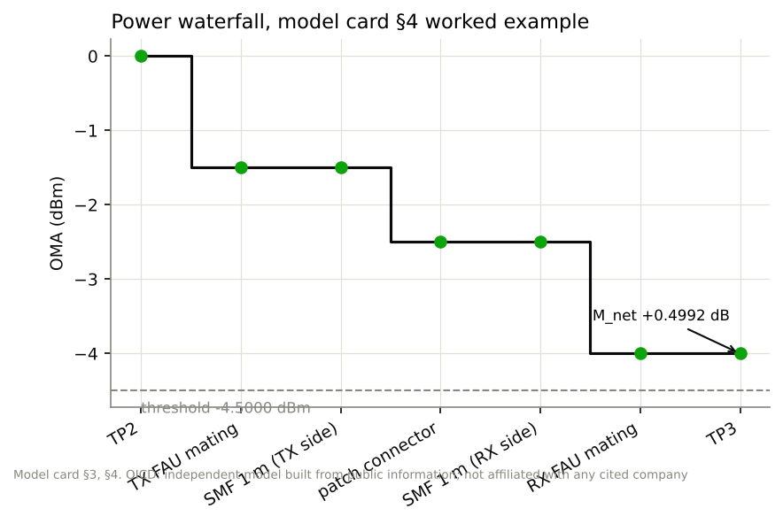
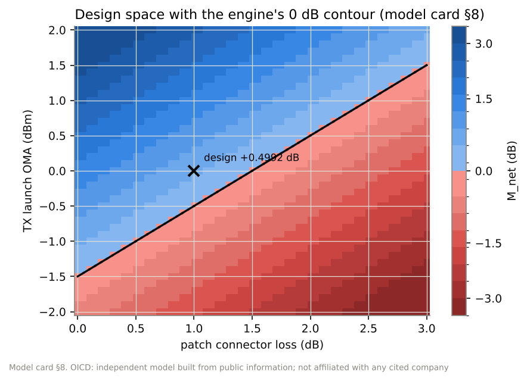

The worked example's design space is a plane with slope −1 dB per dB of connector loss and +1 dB per dB of launch power, and the engine's contour marks where it crosses zero (§8).

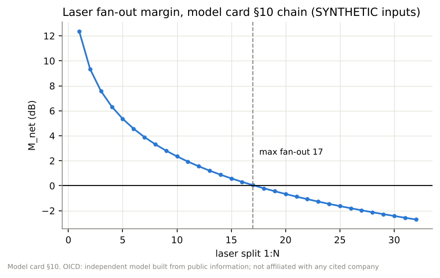

With the §10 laser chain [SYNTHETIC], a 20 dBm laser supports a 1:17 split and fails at 1:18 (−0.2034 dB) [INFERENCE].

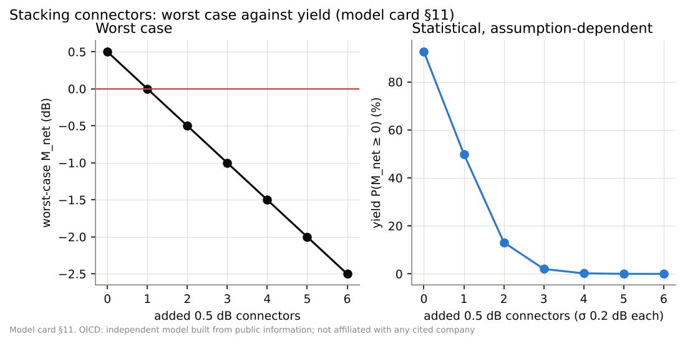

Each added 0.5 dB connector costs exactly 0.5 dB of worst-case margin; the statistical yield collapses faster because the mean margin shrinks while σ_total grows (§11).

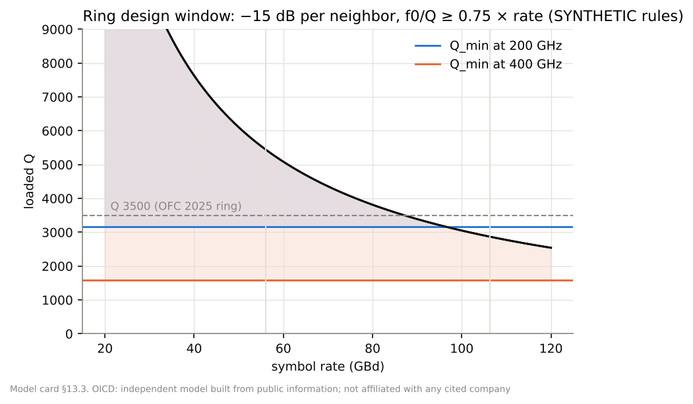
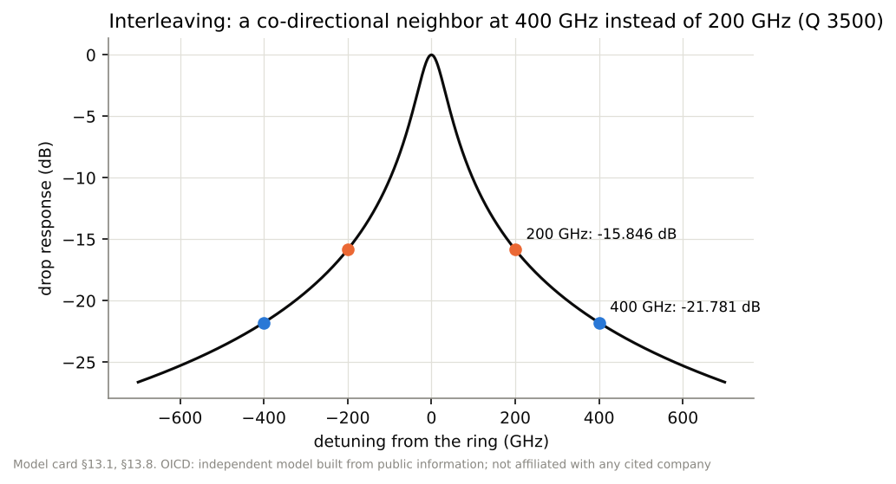

For a microring at 1310 nm with Q 3500 [VENDOR_CLAIM, vendor_ofc25_talk], taken as loaded (an assumption), the FWHM is 65.3855 GHz and a single co-directional neighbor 200 GHz away leaks −15.846 dB, 400 GHz away −21.781 dB: interleaving the two directions of a bidirectional link on alternate 200 GHz slots gains 5.935 dB of isolation [INFERENCE] (§13). The design window of SYNTHETIC rules (−15 dB per neighbor, f0/Q ≥ 0.75 × symbol rate) is open at 56 GBd for both spacings and closed at 106.25 GBd for 200 GHz.

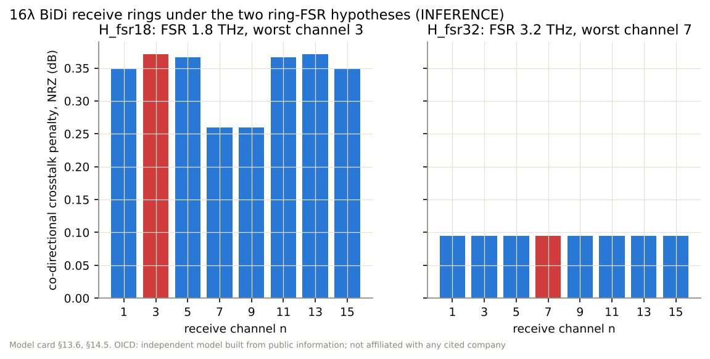

The 16-wavelength bidirectional link's ring FSR is not disclosed. Under H_fsr18 (the OFC 2025 ring's 1.8 THz, nine slots [PEER_REVIEWED]) seven of eight receive rings have an image exactly on a local transmit channel and the worst receive channel sees co-directional leakage 0.081869 and an NRZ penalty of 0.3710 dB; under H_fsr32 (3.2 THz) the worst is 0.0944 dB [INFERENCE] (§14.5). A 1.8 THz ring erases most of the interleaving gain; the link wants an FSR of at least 3.2 THz, which for a group index of 4.2 [SYNTHETIC] means a ring radius of at most 3.5501 µm.

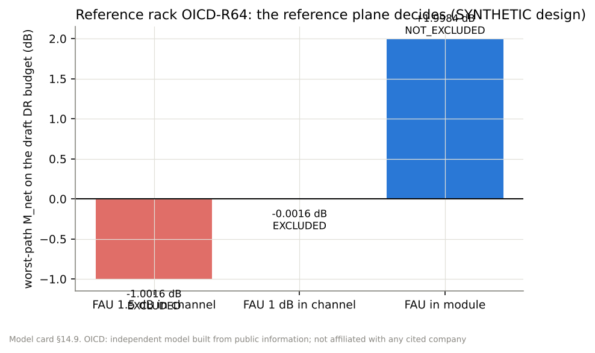
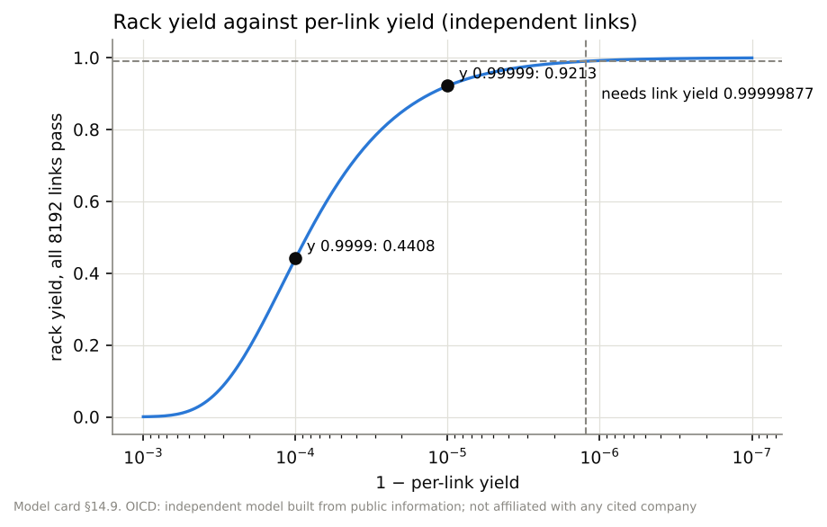

The reference rack OICD-R64 [SYNTHETIC design] places 16 XPU trays and 8 switch trays in an ORv3 frame [PUBLISHED_SPEC, ocp_orv3_meta] with a single-tier topology of 8192 BiDi links. Its worst path on the draft DR budget is −1.0016 dB with the 1.5 dB FAU [VENDOR_CLAIM, vendor_pr_fau] in the channel, −0.0016 dB at "below 1 dB" [THIRD_PARTY, futurum_ocp26], and +1.9984 dB when the FAU belongs to the module side of the reference plane [INFERENCE] (§14.9). The verdict depends on where the plane is drawn. Over 8192 independent links, a 99 % rack needs per-link yield 0.99999877 [INFERENCE].

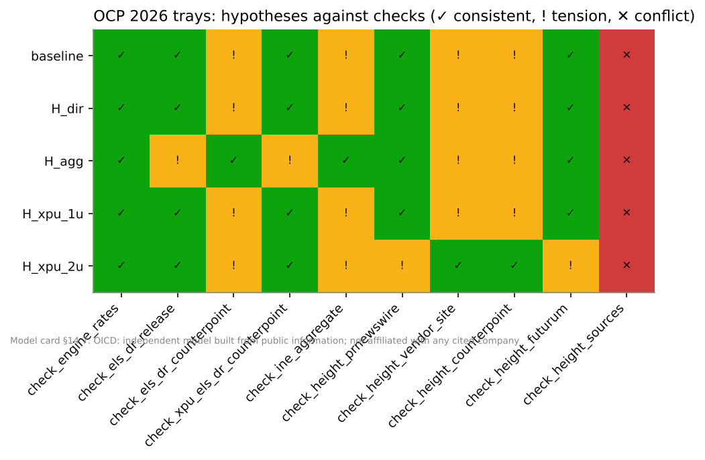

The support matrix shows the 204.8 Tbps switch tray read per direction (four ELS-DR modules, agreeing with the vendor's release [vendor_pr_els_dr]) or as an aggregate (two modules, agreeing with [counterpoint_ocp26] and [ine_ocp26]); neither reading is dropped (§14.7).

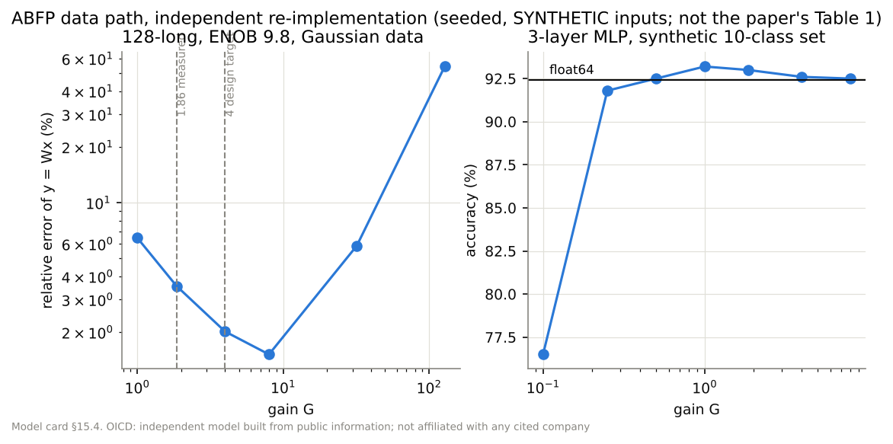

For the photonic processor of [ahmed2025_nature], OICD re-implements the adaptive block floating-point data path independently from the paper's Supplementary Information and [basumallik2022_abfp]; it is not the authors' code (§15). The published counts multiply out: 4 × 128 × 128 MACs at 500 MHz give 65.536 TOPS against the stated 65.5 [INFERENCE]. (A per-core power split could not be checked: the main text is paywalled, and the Supplementary Information's Table S3 gives 250 mW per core.) The SI's quantizer can be read with the ADC range ±n (H_out_n) or literally ±1 (H_out_1); only the first agrees with the SI's 24-bit output word, and the literal reading clips most sums. On synthetic data, the matrix-vector error falls from 6.5 % at G = 1 to 2.0 % at G = 4 (the SI's emulation setting) and rises again once the ADC clips [INFERENCE on SYNTHETIC inputs]; these are not the paper's Table 1 results, which are cited as measured.

## 6. Case study: architecture twins from public material

OICD's catalog models the building blocks of current photonic interconnect for AI from public papers, standards and technical material (docs/twin/): a 3D active photonic interposer, co-packaged optics chiplets, a two-wavelength BiDi DR optical engine and its CPX variant, CPO switch and accelerator trays in an Open Rack, external laser sources, a detachable fiber-array unit, a 16-wavelength single-fiber BiDi link on microring transceivers, a scale-up pod and a photonic tensor-core processor. Of its 497 facts, 453 were verified against their source by exact quote; of the other 44, 39 keep their initial wording and say why they could not be verified, and 5 record that a value is not disclosed. The public numbers are mostly self-consistent: 256 fibers at 448 Gb/s give 114.688 Tbps against a stated 114 Tbps, and 30 W over 6.4 Tbps is 4.6875 pJ/bit against a stated 5 pJ/bit [INFERENCE]. The design lessons come from carrying them through the physics. A two-wavelength BiDi plan at 1311 nm and 1331 nm places the second direction 13.5 nm above the draft DR wavelength range, so wavelength compliance has to be argued per direction [INFERENCE]; a single-fiber 16-wavelength plan needs ring FSR ≥ 3.2 THz before interleaving pays off (§5); and where a rack's verdict depends on which side of a detachable fiber-array unit the budget is measured, the reference plane has to be written down before any number is compared (§5).

## 7. Limitations

Every link verdict is worst case on a modeled subset of constraints: BER, TDECQ, dispersion, thermal behavior and reliability are NOT_EVALUATED. The crosstalk penalty form is an inference, with an alternative form reported beside it; the statistical yield assumes independent normal losses, although connector loss is non-negative and skewed. The twin is limited to public information and the sources that could be opened; the photonic processor's main text was paywalled, so its facts come from the Supplementary Information and figure pages. The reference rack is an OICD design. Draft IEEE 802.3dj values may change before approval. The explorer's geometry is schematic wherever a dimension is not public, and says so part by part.

## 8. Related work

Microring modulators and filters [bogaerts2012_mrr], their thermo-optic tuning [frey2006_dndt, xu2014_thermo], dispersion of the group index [decort2011] and bandwidth subtleties [geravand2025_mrm, hu2025_arxiv] ground §13; WDM optical I/O on a monolithic processor was demonstrated by [sun2015_nature]. Interference in bidirectional and multi-reflection links follows [bhatt2001_bidixtalk, bhatt2016_mpi, anslow2017_drrefl, andre2000_xtalk]. Coherent photonic matrix processors [shen2017, clements2016] differ from the processor of [ahmed2025_nature], which multiplies on photocurrent inside each weight cell. External laser sources are standardized by the OIF ELSFP agreements [oif_elsfp_01, oif_elsfp_02] and co-packaged modules by [oif_cpo32]; open rack hardware by [ocp_orv3_base, ocp_orv3_meta, ocp_orv3_hpr72, ocp_nic3]; the open silicon photonics vision by [ocp_osp_vision_2026]. Language-model-assisted design search is an active area [gu2026llmcircuits].

## Acknowledgments

The code, tests and documents of OICD were written with an AI coding assistant, which also proposed design decisions that the author reviewed; the models and physics are the author's.

## Disclaimer

Independent model built from public information. Not affiliated with or endorsed by any company whose publications are cited.
